# 20 MHz GNSS驯服频率源技术总结报告

AMD 自主选题初级组　2026 年 11 月 2 日

摘要

本系统面向连续频率参考应用，以 AX7010（Zynq-7010）为核心平台，利用 GNSS 接收机的 1PPS 对 20 MHz 恒温晶振（OCXO）进行频率驯服。PL 完成周期计数、CARRY4 延迟链分数测量、NMEA 串行接收和 AXI 寄存器接口；PS 完成相位与频率状态估计、数据有效性判定、DAC 调节及人机交互，构成板上独立运行的闭环频率控制系统。

系统采用两状态卡尔曼估计与受限 C 补偿慢环。慢环扣除已知 DAC 控制历史造成的相位变化，再重建当前工作点频差，并按估计滞后与有效性调整融合权重。提交配置取 Q_FREQ = 1e−4、R = 80 ns²、稳态更新周期 10 s，关闭相位回零控制。同正常控制配置的 v24 记录在第 20～60 分钟得到 OADEV@100 s = 0.20775 ppb、OADEV@200 s = 0.11476 ppb。最终版已记录 CALIB 保持、失锁后返回 CALIB 及慢环实际参与；稳定度指标相对当次 GNSS 参考，绝对准确度仍待独立验证。

## 第一部分  作品概述

### 1.1 功能与特性

系统提供标称 20 MHz 连续频率输出，以 GNSS 1PPS 约束长期频差。测量通路逐秒获取相位增量、计数与接收质量，控制通路在稳态下每 10 s 更新一次估计及 DAC 命令。串口屏与 PC 日志分别承担本地状态显示和详细诊断。状态机包括 TUNING 闭环调谐、CALIB 冻结 DAC 和 HOLDOVER 参考失效保持；统一快照、样本门控及 NMEA 校验构成控制输入的质量保护。

### 1.2 应用领域

系统适用于时频测量教学、通信原型、数字时钟系统和实验室频率参考研究。Zynq 的软硬件协同结构将确定性测量时序与可配置估计控制分离，便于更换测量算法、观察器和接收质量模型。面向精密计量及长期守时应用时，还应增加独立频率基准比对、环境试验与测量不确定度评估。

### 1.3 主要技术特点

系统的技术特点包括粗细测量结果同事件配对、统一快照与异常序号恢复、已知 DAC 输入补偿及 C 慢环受限融合。相位增量、累计相位和频率估计分别定义并统一量纲；快慢环形成一个融合控制量，经同一 DAC 执行。性能评价直接使用原始测量通道，同时保留状态、新息与融合权重等诊断量。

### 1.4 主要性能指标

| 项目 | 已有结果 |
| --- | --- |
| 标称输出 | 20 MHz |
| 接口刻度 | 0.1953125 ns/LSB |
| OADEV 100 s | 0.20775 ppb |
| OADEV 200 s | 0.11476 ppb |
| 平均相对频差 | −0.01253 ppb |

表 1 为同控制配置 v24 记录第 20～60 分钟的测量结果，参考为当次 GNSS。接口刻度用于数字量换算，绝对准确度需独立基准另行标定。

### 1.5 主要创新点

（1）按实际生效的 DAC 历史积分控制相位，减少长窗拟合与自身调节动作的混叠。

（2）以真实 age、lag、权重渐增和失效退出机制约束慢环，兼顾长期估计与瞬时保护。

（3）将序号一致性、样本有效性和 GNSS 报文新鲜度纳入统一质量保护，并记录候选值与实际控制来源。

### 1.6 设计流程

设计以软硬件接口、量纲与采样时序为起点，依次完成 PL 测量、PS 状态估计、DAC 执行与人机接口集成。验证采用模块编译与回放、整机功能检查及统一时间窗稳定度评价，软件、固件和数据通过版本及校验信息关联。

## 第二部分  系统组成及功能说明

### 2.1 整体介绍

系统由 u-blox NEO-M8T-0-11 GNSS 接收模块、20 MHz OCXO、DAC8531、AX7010 和串口屏组成。GNSS 提供 1PPS 与 NMEA 信息，OCXO 提供被测时钟。PL 在标称 100 MHz FCLK 域完成计数及分数测量，经 AXI4-Lite 将结果交给 PS；PS 生成 DAC 命令，PL 通过 SPI 驱动 DAC，再由模拟电压调节 OCXO 的 EFC 端。Zynq 片内接口支撑软硬件协同[2]。OCXO 接入 K17 作为被计数输入，FCLK 使用独立的 PS 时钟源。

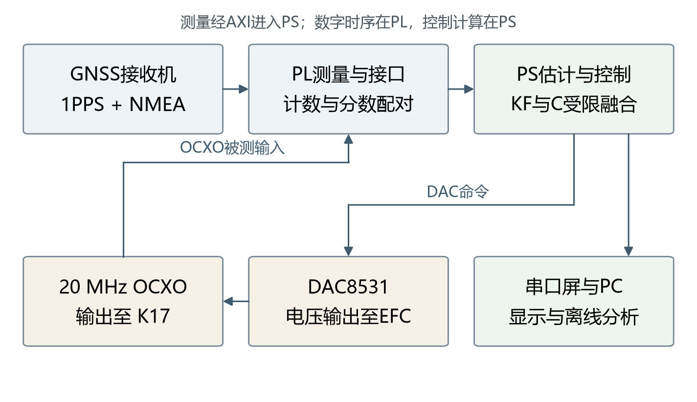

图1 系统总体信号关系

测量数据分为单间隔相位增量、累计相位与频率估计。0x00 寄存器给出单间隔相位增量，PS 累加形成相位观测，卡尔曼状态 X[1] 表示滤波频差。原始测量用于评价相对频率稳定度，状态估计用于控制。PC 仅保存日志并进行离线分析，实时闭环在板上独立执行。

### 2.2 硬件系统介绍

### 2.2.1 硬件整体介绍

| 模块 | 当前实现与作用 |
| --- | --- |
| 开发平台 | AX7010，xc7z010clg400-1；PL执行确定性时序，PS运行裸机软件 |
| GNSS接收机 | u-blox NEO-M8T-0-11；提供1PPS、NMEA及接收质量信息 |
| OCXO | 外壳标称20.00000 MHz，周期50 ns；EFC用于压控调节 |
| DAC | DAC8531，16位器件；当前有效命令12位，左移4位送入DAC |
| 本地交互 | 串口屏、PS按键与指示灯；另有PC调试日志口 |

开发板与 GNSS/OCXO 底板的输入供电均为 5 V，已按实物连接确认。外接板将 GNSS 接收、OCXO 时钟及 DAC 调节接口与开发板连接。

### 2.2.2 机械设计介绍

整机采用模块化搭接结构。AX7010 保留透明保护板及支柱安装，OCXO 与 GNSS 电路位于外接板组件，串口屏独立布置。用户提供的开发板手册图给出 AX7010 PCB 外形 130 mm × 90 mm、8 层设计及 4 个直径 3.5 mm 安装孔。按图 2 方向，右侧 40 针扩展口为 J11，承担本系统 PL 信号；12 针 PS MIO 扩展口用于串口屏。

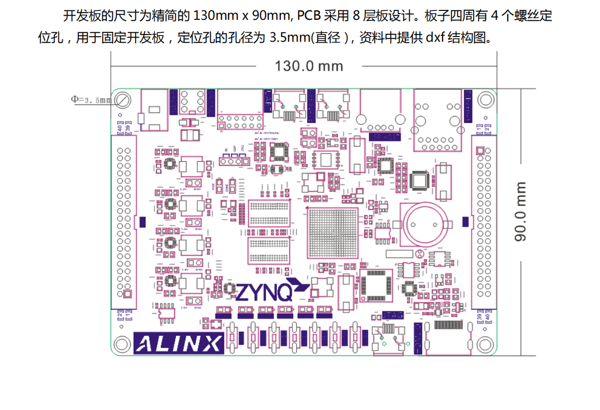

图2 AX7010板卡尺寸与接口位置 手册图

整机当前装配状态的实测外形尺寸为 245 mm × 110 mm × 58 mm（长 × 宽 × 高），即 24.5 cm × 11 cm × 5.8 cm；高度按整机最高点测量。

### 2.2.3 电路各模块介绍

硬件输入包括 GNSS 1PPS、NMEA 串行数据和 OCXO 时钟，输出包括 DAC 串行控制及显示接口。表 3 将当前 XDC 引脚与已确认的 J11 排针脚号对应，供板级接线及复现检查。板卡输入 5 V 与排针的 +3.3 V 电源定义分别标注。

| 链路 | 信号 | FPGA / J11脚号 | 方向 |
| --- | --- | --- | --- |
| GNSS授时 | pps_in | F20 / 5 | 接收机至PL |
| GNSS报文 | uart_rx | F17 / 3 | 接收机TX至PL |
| OCXO计数 | ocxo_in | K17 / 16 | OCXO OUT至PL |
| DAC串行时钟 | spi_sck | G20 / 7 | PL至DAC |
| DAC串行数据 | spi_mosi | H18 / 9 | PL至DAC DIN |
| DAC片选 | spi_cs_n | L20 / 11 | PL至DAC SYNC |

DAC8531 以 24 位串行帧装载数据，并在 SCLK 下降沿接收[4]。本设计发送 8 位控制头与 16 位数据，数据部分为 12 位命令左移 4 位。命令范围 0～4095 并不表示 DAC 器件为 12 位。SPI_DIV = 8 时，现 RTL 的含零计数等待使稳态 SCK 周期为 18 个 FCLK 周期，标称 100 MHz 下约 5.56 MHz。

DAC 输出连接 OCXO 的 EFC 端，构成压控调谐链路。PS 根据估计频差计算命令，PL 将命令转换为 SPI 串行帧，经 DAC 改变调谐电压，进而修正 OCXO 输出频率。

串口屏使用 PS UART0（9600，8N1）：J12-9 为 MIO14/C5，接屏幕 RX；J12-3 为 MIO15/C8，接屏幕 TX。调试日志使用 PS UART1（115200，8N1）。KEY1 位于 MIO50，用于 TUNING 与 CALIB 切换，双击可强制回 TUNING；KEY2 位于 MIO51，用于屏幕翻页。提交配置的状态灯为 PS LED1（MIO0，低电平点亮），闪烁节奏按频差幅值确定。

### 2.3 软件系统介绍

### 2.3.1 软件整体介绍

PS 软件采用主循环与周期任务组织。主循环处理 GNSS 字节及人机接口，逐秒任务完成测量采集、状态检查和显示刷新；独立控制节拍决定卡尔曼观测更新与 DAC 调节。启动首次更新为 1 s，随后固定为 10 s，显示刷新与控制更新保持各自时序。

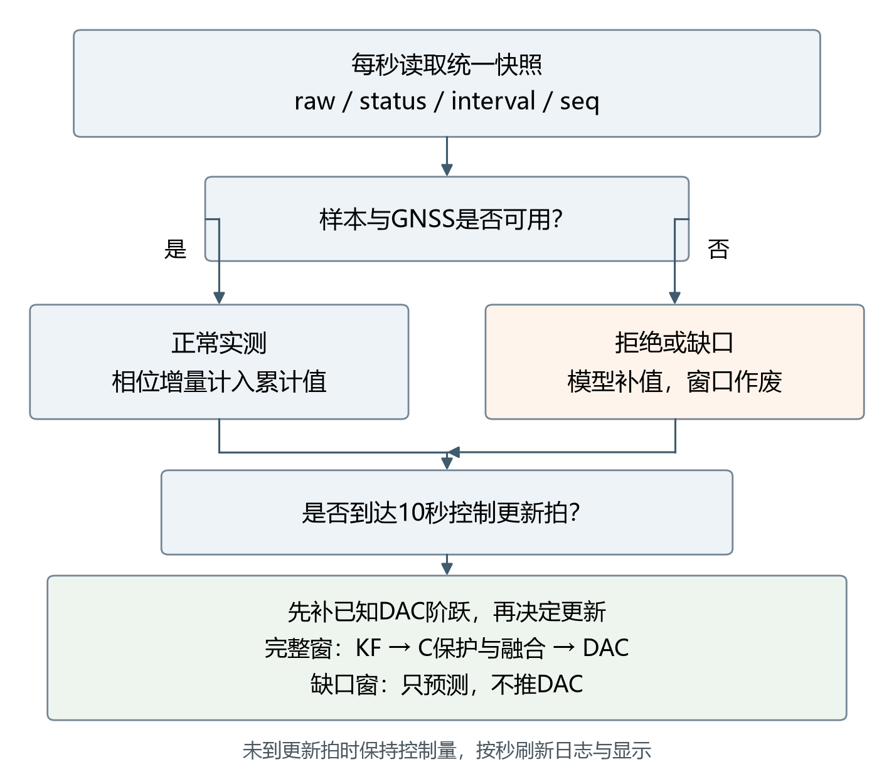

图3 逐秒采集与控制更新关系

提交配置为 Q_FREQ = 1e−4、R = 80 ns²、稳态 Tu = 10 s、相位回零关闭及 MODE2。R 训练和自适应周期保留为扩展。启动日志输出版本、观察器及融合配置，供运行核对。

### 2.3.2 软件各模块介绍

| 模块或入口 | 关键输入 | 关键输出与职责 |
| --- | --- | --- |
| bsp_snapshot_take / classify | raw、status、间隔计数、seq0/seq1 | 同一快照及OK、SAT、TORN、DUP、GAP、NO_MEAS判定 |
| GNSS解析 | NMEA字符、报文校验和、到达时间 | 定位、SAT、HDOP、CN0与独立GGA新鲜度 |
| kalman更新 | 累计相位、T、R、Q及已知DAC输入 | X[0]、X[1]、协方差、新息和S |
| slow_c_observe / current | 相位、实际DAC历史、时间戳 | C、参考工作点频率、当前候选、age与lag |
| 融合与control_apply_freq | 快慢候选、实际权重与频差 | DAC累计值、量化命令和实际来源 |
| 状态机与screen | 接收质量、按键、样本质量 | TUNING/CALIB/HOLDOVER及两页显示 |
| PC分析 | 原始日志和配置记录 | 连续性检查、同窗OADEV和可复核图表 |

PL 测量由 OCXO 周期计数和 128 个 CARRY4 构成的 512 抽头延迟链配合完成。CARRY4 利用器件的快速进位结构实现细分测量[3]，抽头间隔仍受布局、工艺与温度影响。粗计数与同秒分数结果在发布前配对，由 meas_done 标记完整结果，保持单次测量内部的一致性。

单间隔 Q16 结果为 (N − 20000000)×65536 + frac_now − frac_prev，再经加 128 舍入、算术右移 8 位及 32 位饱和处理发布。0x00 的数字换算刻度为 50/256 ns，即 0.1953125 ns/LSB。当前细分采用固定缩放；抽头物理标定及温度补偿仍属于后续完善内容。

PS 将 raw、状态、OCXO/FCLK 间隔计数和序号纳入统一快照，检查饱和、撕裂、重复、间隔异常与测量缺失。可靠发布的序号独立于测量是否被接受而推进，使异常后的正常样本能够恢复。缺口所在控制窗只执行状态预测并保持 DAC，内部连续性补值单独标记，同时使慢环旧窗口失效。

卡尔曼状态定义为 X = [累计相位 ns，频差 ppb]，状态转移满足 X[0](k+1) = X[0](k) + T×X[1](k)。模型将已知 DAC 阶跃按 0.47852 ppb/命令码补入频率状态，再执行预测及相位观测更新。DAC 采用带累计和限幅的频率积分控制。提交配置关闭 K_PHASE×X[0] 回零项，允许保留启动相位偏置；相位观测仍用于频率估计，设计目标为频率驯服。

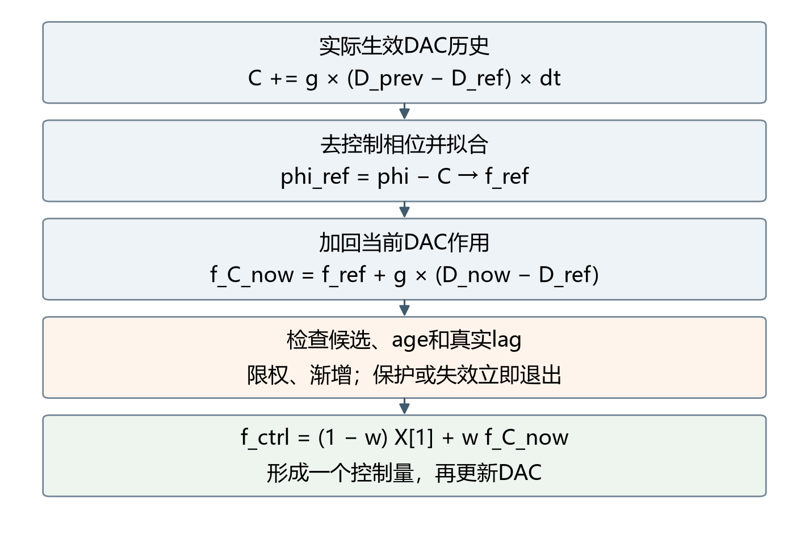

图4 C补偿与受限慢环融合

C 补偿以实际 DAC 历史积分控制相位，由 phi_ref = phi − C 拟合 f_ref，并重建 f_C_now = f_ref + g×(D_now − D_ref)。快慢估计统一融合为 f_ctrl = (1 − w)×X[1] + w×f_C_now，经同一 DAC 执行。

慢环每 300 s 采点，保留 2～3 点。span ≥ 240 s 时可接入；末点年龄 age > 330 s、拟合滞后 lag > 630 s 或发生异常时退出。按真实 lag 计算统计权重，目标为 min(0.1，0.1×w_stat)，每秒上升不超过 0.1/300，下降立即跟随。

CALIB 硬冻结 DAC 并保留原始测量。HOLDOVER 按 1 s 预测，在连续有效观测后恢复原状态。NMEA 先校验再更新，GGA 新鲜度单独判断；保护与日志共用候选快照。

## 第三部分  完成情况及性能参数

### 3.1 整体介绍

整机已完成 GNSS、OCXO、DAC 与 Zynq 的连接及闭环运行。图5、图6 展示实物模块分布、外接板安装、天线接口与串口屏布置，反映当前原型的实际集成形式。

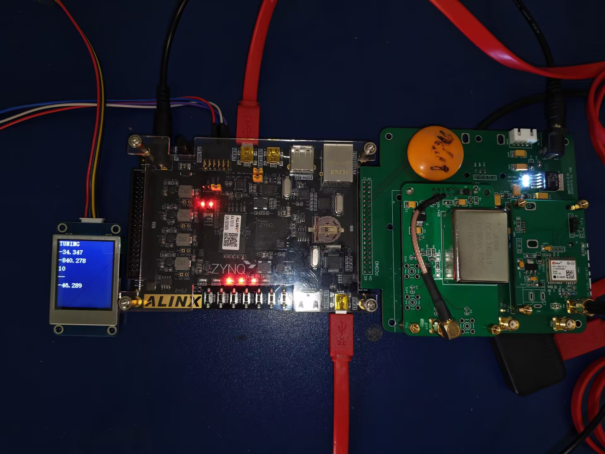

图5 系统正面实拍

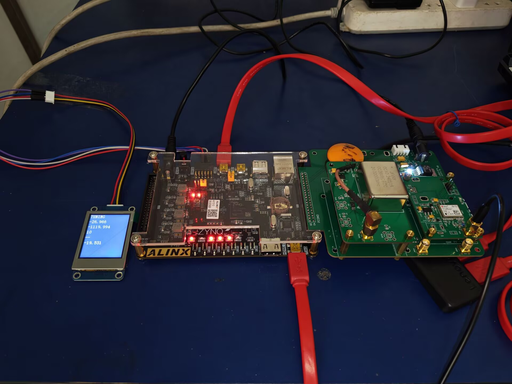

图6 系统约45度视角实拍

### 3.2 工程成果

### 3.2.1 机械成果

当前机械成果为模块化原型装配。开发板采用透明保护板与支柱，外接板通过连接器及支柱形成可拆卸结构，串口屏与线缆采用外置布置。图5、图6 已展示实际安装关系；后续结构定型应重点完善屏幕固定、线缆应力释放、板卡绝缘与散热空间。

### 3.2.2 电路成果

OCXO、DAC 与 GNSS 电路已完成板级装配。图 7 为 OCXO 板近照，图 8 标示 DAC 区域，图 9 补充整块外接组件及 GNSS 局部近景。实物标签可辨识接收模块为 u-blox NEO-M8T-0-11，底板供电区器件标记为 LT1963 EQ-3.3。照片用于展示实际器件、接口和模块装配关系。

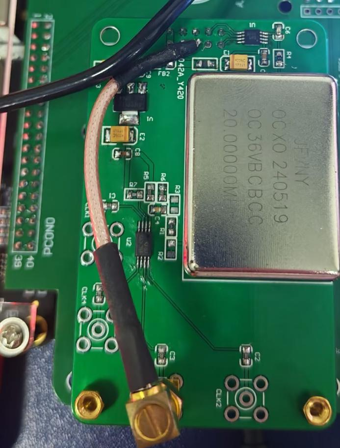

图7 OCXO板实物近照

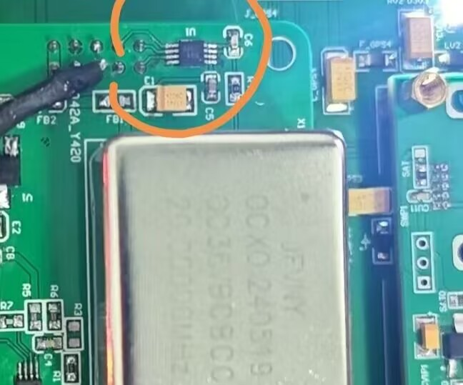

图8 DAC所在位置实拍

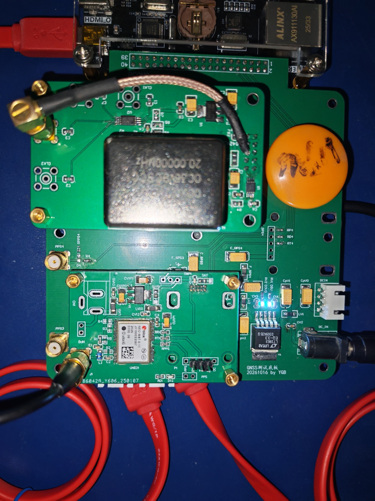

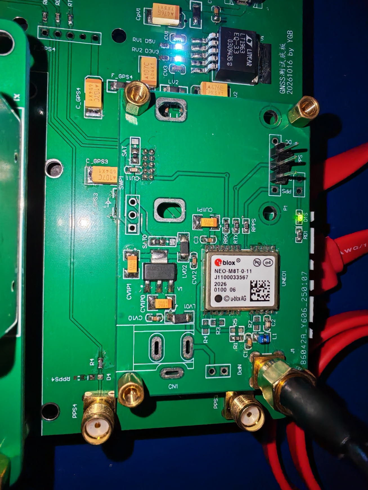

图9 外接板组件与GNSS模块PCB近景

### 3.2.3 软件成果

软件形成串口屏与 PC 日志两级交互。代码定义 page0 为控制状态页，依次显示状态、X[1] 频差、X[0] 累计相位、Tu、慢环周期及本秒相位增量；page1 为 GNSS 页，依次显示定位、卫星数、HDOP、CN0、纬度、经度、UTC 与日期。图10 左为 page0、右为 page1。实拍中 UTC 格式尚待完善，日期当前显示“--”；慢环周期显示与实际融合权重分别记录。

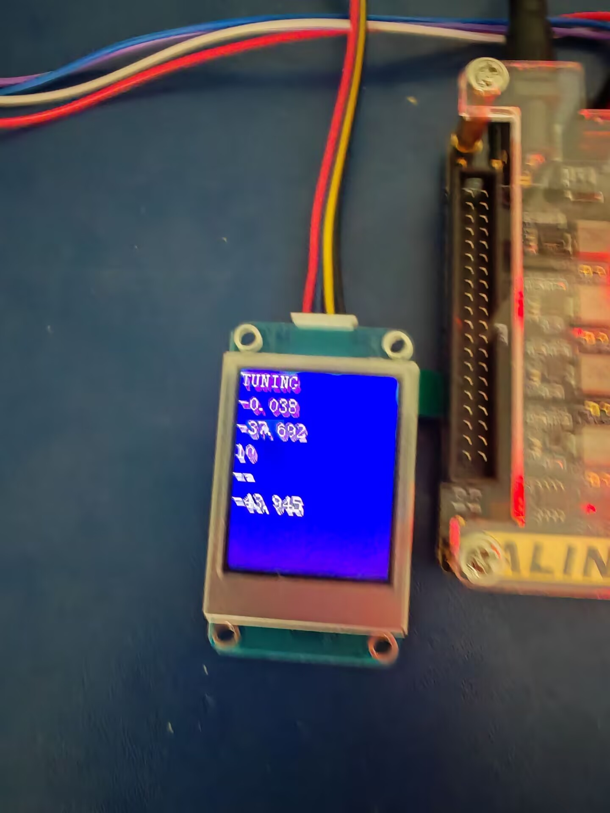

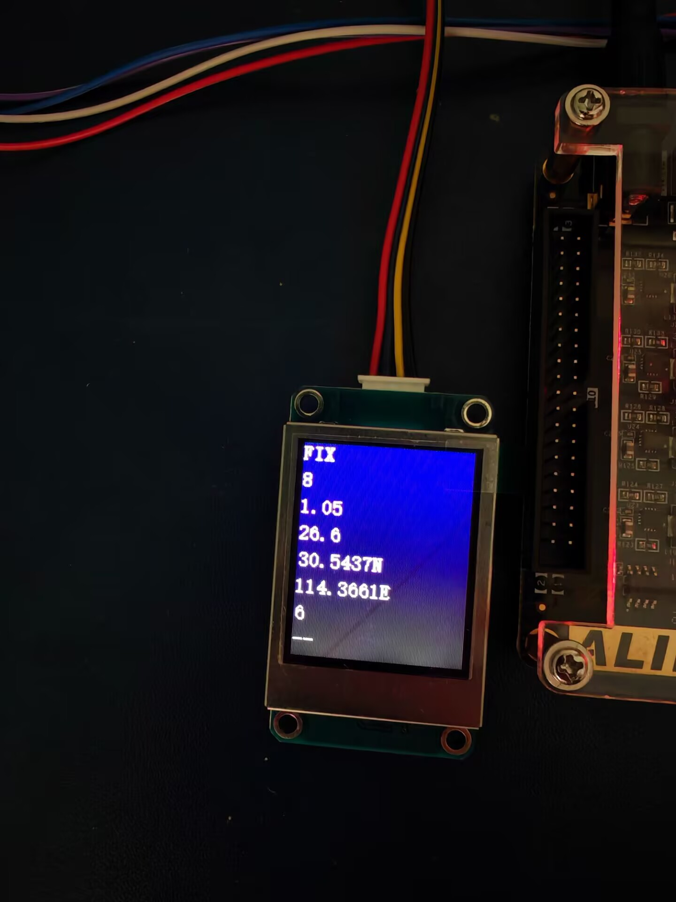

图10 串口屏控制状态页page0与GNSS信息页page1

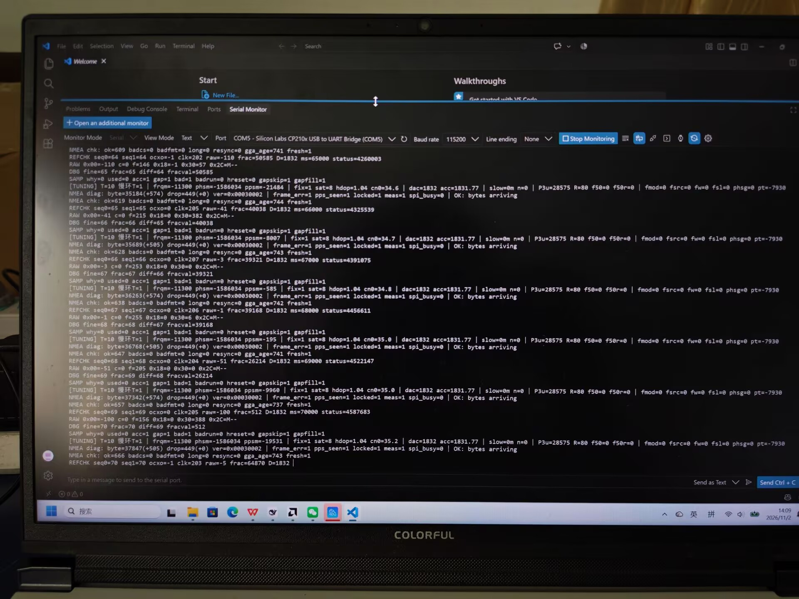

图11 PC串口运行日志实拍

图11 展示 REFCHK 原始测量、SAMP 样本判定与 NMEA chk 校验记录。why 表示当前样本判定，acc 表示是否计入相位，used 仅在实际控制更新拍置位；bad 与 gapfill 为累计诊断计数。照片中 fmod = 0，属于慢环关闭配置的界面示例，慢环实际参与与性能采用第 3.3 节的对应配置记录评价。

### 3.3 特性成果

### 3.3.1 功能实现与验收状态

| 功能 | 已有证据与当前状态 |
| --- | --- |
| 测量及频率闭环 | 连续原始日志、DAC轨迹与启动记录；本次最终版配置有启动日志对应 |
| 样本门控与NMEA校验 | 本次参考失效期间出现拒绝和缺口补值，恢复后重新放行；hreset全程为0 |
| CALIB冻结 | 本次CALIB及HOLDOVER期间，DAC命令均保持1851 |
| C慢环实际参与 | 本次连续37次更新src=2且权重非零；历史v24性能窗口240/240次参与 |
| 最终ELF | BUILD为2026-11-02 15:29:18；覆盖CALIB失锁后返回CALIB，原始记录见[7] |

提交默认固件 gpsdo_final_c.elf 采用本次验收对应的重编译文件，BUILD 为 2026-11-02 15:29:18；29 个 PS 源文件与原冻结提交源码逐字节相同。回退固件 gpsdo_baseline_mode0.elf 保留 MODE0。归档 ELF 的校验值与启动配置建立版本对应；启动日志本身不构成板上内存逐字节校验。

本次功能记录共 1154 条：122～343 s 为 CALIB，344.008～455 s 为 HOLDOVER，456～475 s 自动返回 CALIB，三个阶段 DAC 命令均为 1851。再次进入 TUNING 后，在 787～1147 s 连续 37 次更新出现 src = 2 且实际权重非零，范围 0.3333%～6.0418%，硬复位计数始终为 0[7]。

本次恢复后的 CALIB 记录为 20 s，短于操作指南建议的 60 s；尚未单独覆盖 TUNING→HOLDOVER→TUNING 路径。故障期间的缺测及模型补值用于恢复验证，不并入性能统计。

### 3.3.2 启动与控制过程

图 12 展示 v24 的开机频率估计与 DAC 调整过程。启动时存在初始限幅和收敛过程，DAC 随控制量调整后进入工作区间。该记录 BUILD 为 2026-10-31 17:57:44，与最终版正常控制配置相同；最终默认固件采用 2026-11-02 15:29:18 版，本次功能验收见第 3.3.1 节。

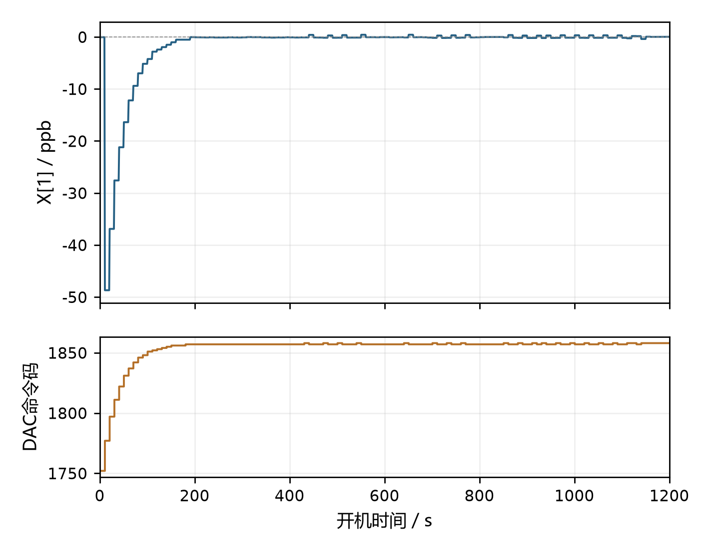

图12 同控制配置的启动估计与DAC调整

### 3.3.3 相对频率稳定度与等效换算

系统采用重叠阿伦偏差（OADEV）评价相对频率稳定度。对逐秒原始频率样本作 m 点滑动平均，将相隔 m 个采样位置的均值作差，计算平方差均值的一半再开方。该方法直接对应原始测量通道，并将平均频差、估计状态波动和频率稳定度分别统计[1]。

稳定度统一使用 v24 开机第 20～60 分钟的 2400 个有效逐秒样本。原始寄存器乘 0.1953125 得相位增量 ns；在 1 s 测量间隔下，ns/s 与 ppb 数值相同。对 20 MHz，1 ppb 对应 20 mHz、1 ns/s 及 10⁻⁷%。表 4 的漂移率单位用于表达频率波动尺度。

| τ/s | OADEV/ppb | 等效20MHz频差/mHz | 漂移率波动/ns/s | 相对稳定度/% |
| --- | --- | --- | --- | --- |
| 1 | 13.21072 | 264.214 | 13.21072 | 1.3211×10⁻⁶ |
| 10 | 1.24492 | 24.898 | 1.24492 | 1.2449×10⁻⁷ |
| 100 | 0.20775 | 4.155 | 0.20775 | 2.0775×10⁻⁸ |
| 200 | 0.11476 | 2.295 | 0.11476 | 1.1476×10⁻⁸ |
| 300 | 0.06715 | 1.343 | 0.06715 | 6.7145×10⁻⁹ |
| 600 | 0.03753 | 0.751 | 0.03753 | 3.7531×10⁻⁹ |

该 2400 s 记录的平均相对频差为 −0.01253255 ppb，对应 20 MHz 平均频率偏差 −0.2507 mHz、平均时间漂移率 −0.01253255 ns/s 和相对偏差 −1.25326×10⁻⁹%；原始相位增量之和为 −30.0781 ns。上述均值与稳定度分别描述有限记录的平均偏移和波动特性，绝对准确度尚需外部基准确认。

### 3.3.4 慢环参与与稳定度对照

慢环验证采用关、开、关的交错配置，其余控制参数固定为 R = 80 ns²、Q_FREQ = 1e−4、Tu = 10 s 和相位回零关闭。三轮均使用第 20～60 分钟的相同长度原始记录，结果见下表与图13[6]。

| τ/s | v23 关/ppb | v24 开/ppb | v25 关/ppb |
| --- | --- | --- | --- |
| 100 | 0.17683 | 0.20775 | 0.22687 |
| 200 | 0.16112 | 0.11476 | 0.13372 |
| 300 | 0.14632 | 0.06715 | 0.10049 |
| 600 | 0.05659 | 0.03753 | 0.05240 |

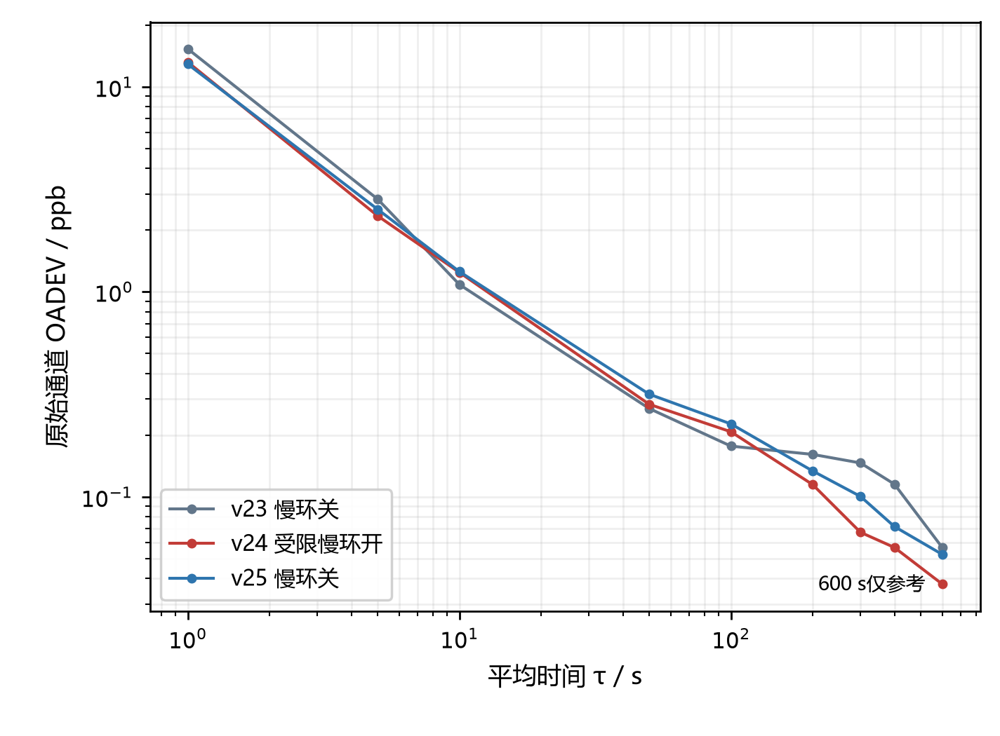

图13 相同时间窗的慢环关开关OADEV对照

开启记录在 τ = 200～600 s 时低于两轮关闭记录，100 s 时位于二者之间，显示部分长周期改善信号。v24 性能窗口中慢环参与 240/240 次更新，平均实际权重 4.4796%，表明受限融合已进入控制通路。当前仅有一轮开启对照，尚不足以确认稳定度收益的可重复性；600 s 结果仅作参考。

### 3.3.5 R模型研究与配置选择

R 的选择采用离线残差建模和整轮留出验证。固定 DAC 条件下，将累计相位在局部窗口内作线性去趋势，以残差平方和除以自由度形成标签，再比较常数模型、HDOP/SAT/CN0 四参数模型及约束模型。统一核算选用三轮冻结记录，共 331 个 40 s 窗口[6]。

整轮留出检验的按轮等权 RMSE，常数模型为 11.716 ns²、线性四参数为 12.202 ns²、单调约束四参数为 11.994 ns²。20 s 与 60 s 窗口敏感性检查亦未显示四参数的稳定优势。该结果支持现阶段采用固定噪声设置，并将质量自适应留作待验证扩展。

残差标签同时包含 GNSS 参考、TDC 量化、局部 OCXO 变化和相关噪声，不能直接等同于卡尔曼纯观测方差。不同日期记录的标签均值及回归系数存在变化，现有接收质量指标尚不足以建立稳定的跨轮映射，也不能单独将变化归因于天气。

提交配置保留 R = 80 ns²，关闭旧在线训练入口。该取值是已测试控制配置的工程选择。后续自适应模型应分别验证标签定义、跨轮预测、新息一致性及闭环输出收益，通过后再接入控制。

### 3.3.6 实现资源与性能边界

| 项目 | 已有PL实现结果 |
| --- | --- |
| Slice LUT | 2363/17600，13.43% |
| Slice Register | 2726/35200，7.74% |
| FCLK标称频率 | 100 MHz |
| WNS / WHS | 0.592 ns / 0.037 ns |

PL 资源与时序数据取自 2026-10-28 实现报告[5]，表明现有方案在 Zynq-7010 上具有资源余量。报告仍有 4 项输入输出延迟相关的方法学告警，外设约束需要继续完善。现有频率指标均相对当次 GNSS 参考；在缺少独立可溯源仪器比对时，暂不给出绝对准确度、UTC 相位上界或 OCXO 本体稳定度。

## 第四部分  总结

### 4.1 可扩展之处

后续重点为 DAC 工作点增益及模拟响应标定、延迟链标定和温度记录，以及独立频率基准验证。R 自适应应统一标定标签与运行观测模型，并以整轮留出检验泛化能力；Tu 自适应应同步处理控制律时间归一化、Q(T) 和门限单位。慢环收益需增加等长交错对照，机械固定和显示格式亦需完善。

### 4.2 技术总结与设计体会

本项目完成了基于 Zynq 的测量、估计与执行闭环。PL 承担边沿捕获、粗细配对和串行接口，PS 承担状态估计、质量判定与控制。两者通过统一寄存器和明确的量纲约定协作，使单间隔增量、累计相位、频差估计及 DAC 输入具有一致的时间关系。

控制设计的主要成果是将已知 DAC 作用显式纳入快慢估计，并通过真实滞后、权重渐增和失效退出约束长期候选。样本序号、原始值、拒绝原因、新息及实际融合权重形成完整诊断链，便于定位异常及复算性能。原始 OADEV 与平均频差作为输出评价量，估计状态的平滑程度作为辅助观察量。

现有结果表明，系统具备频率驯服、受限慢环参与、DAC 冻结和接收质量诊断能力。本次功能记录还覆盖 CALIB 失锁保持及恢复。部分长周期指标呈改善信号，但参数最优性、独立准确度及环境适应性仍需进一步验证。后续工作以模拟链路标定、更完整异常路径覆盖和可重复性能评价为重点。

## 第五部分  参考文献

[1] RILEY W J, HOWE D A. Handbook of Frequency Stability Analysis: NIST Special Publication 1065[M]. Gaithersburg: National Institute of Standards and Technology, 2008. https://www.nist.gov/publications/handbook-frequency-stability-analysis.

[2] AMD. Zynq 7000 SoC Technical Reference Manual: UG585, Version 1.15[EB/OL]. (2026-02-06)[2026-11-01]. https://docs.amd.com/r/en-US/ug585-zynq-7000-SoC-TRM/Documentation.

[3] AMD. 7 Series FPGAs Configurable Logic Block User Guide: UG474[EB/OL]. [2026-11-01]. https://docs.amd.com/r/en-US/ug474_7Series_CLB.

[4] TEXAS INSTRUMENTS. DAC8531 Low-Power Rail-to-Rail Output 16-Bit Serial Input Digital-to-Analog Converter: SBAS192B[DS/OL]. (2003-06)[2026-11-01]. https://www.ti.com/lit/ds/symlink/dac8531.pdf.

[5] 本项目. PL资源利用率与实现时序报告[R]. 2026-10-28. 提交包build/reports/。

[6] 本项目. 原始测量记录与频率稳定度及噪声模型复算资料[DS]. 2026-10-30至2026-11-01. 提交包data/raw_support/、data/results/及项目report/analyses/。

[7] 本项目. 最终固件板上功能验收原始记录及核算结果[DS]. 2026-11-02. 提交包 data/raw_support/log_20261102_v27.dat、data/csv/acceptance/及 docs/hardware_acceptance_20261102.md。
